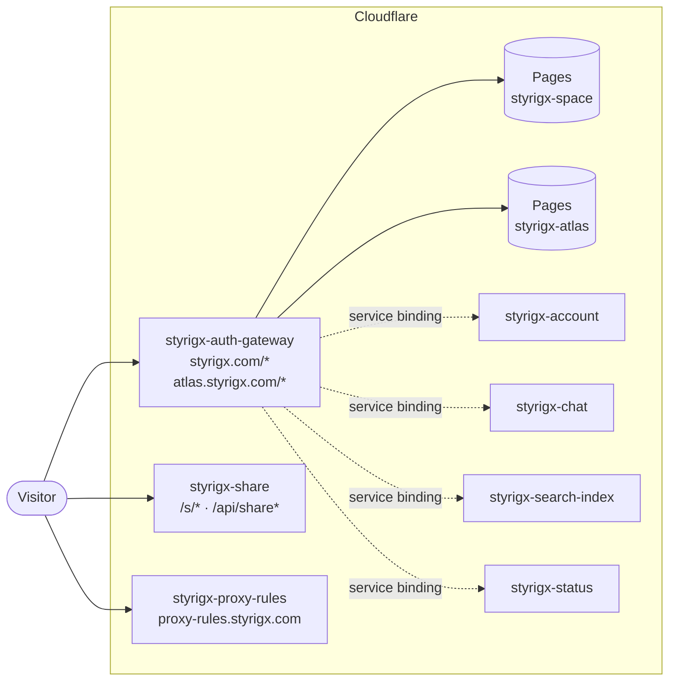

<div align="center">

[中文](README.md) | English

# Styrigx's Space

**To understand the world, take it apart; to believe in it, put it back together.**

Sloan Gray's personal portal — Home, Chat, Settings and Account — and the auth gateway that guards the whole site family.

[styrigx.com](https://styrigx.com) · [Atlas atlas.styrigx.com](https://atlas.styrigx.com/blog/en/) · [GitHub @styrigx](https://github.com/styrigx) · [X @styrigx](https://x.com/styrigx)


</div>

---

## Contents

- [Overview](#overview)
- [Preview](#preview)
- [Apps](#apps)
- [Architecture](#architecture)
- [Security model](#security-model)
- [Styrigx UI](#styrigx-ui)
- [Local development](#local-development)
- [Testing and CI](#testing-and-ci)
- [Repository layout](#repository-layout)
- [Site family](#site-family)
- [License](#license)

## Overview

This is the source of styrigx.com and the "system" repository of the site family:

- **Portal** — four apps (Home, Chat, Settings, Account), fully bilingual.
- **Auth gateway** — every page and API on the main site and on Atlas (atlas.styrigx.com) goes through it first. The whole site is locked by design; sharing only happens through short links that carry a visitor key.
- **Shared shell** — the top bar, navigation drawer and search layer are generated here; Atlas syncs them at a pinned commit.
- **Shared CI** — Hugo, Node and Playwright setup are published as composite actions (`v*` tags) that Atlas references by tag.

The interface is **Styrigx UI**, built in-house, with version numbers that track One UI; the **SGX** kernel handles sign-in and sessions. It works on phone, tablet and DeX, and feels much like a Samsung phone.

## Preview

|  |  |
|:---:|:---:|
| Home | Settings |


<p align="center">DeX</p>

## Apps

| App | Path | What it does |
|---|---|---|
| Home | `/en/` | Profile card, dual clocks, weather, Daymark's quote of the day, screen time. |
| Search | Navigation drawer footer | In-place search layer (no page change): on-site results, or hand off to your chosen search engine. |
| Chat | `/en/chat/` | Web-grounded Q&A (admin only): Gemini 2.5 Flash with Google Search grounding, streamed with sources; the conversation lives only in the current tab. |
| Settings | `/en/settings/` | Display, language, layout and other system settings, stored locally and synced once you sign in. Admins also see service status (uptime and incidents for the main site, Atlas and Proxy rules) and temporary keys (including share links). |
| Account | `/en/account/` | Opened from the avatar in the drawer head (admin only): account sign-in, cloud sync, devices, account security. |

## Architecture



| Worker | Responsibility | Entry |
|---|---|---|
| `styrigx-auth-gateway` | Issues and verifies lock sessions, lock credentials, admin APIs; checks the session on every page before serving it from Pages | `styrigx.com/*`, `atlas.styrigx.com/*` |
| `styrigx-account` | Account system: password, passkeys, devices, account root key, avatar, cloud sync, digital wellbeing | Gateway service binding only, no public route |
| `styrigx-share` | Share short links and their admin API | `styrigx.com/s/*`, `styrigx.com/api/share*` |
| `styrigx-chat` | Chat backend; forwards to the model, stores nothing | Gateway service binding only |
| `styrigx-search-index` | Site-wide search (KV index) | Gateway service binding only |
| `styrigx-status` | Checks every minute, reads usage hourly (D1) | Gateway service binding only |
| `styrigx-proxy-rules` | Accelerating proxy for rule sets, allow-listed upstream only | `proxy-rules.styrigx.com` (bypasses the gateway) |

Atlas's two API Workers (`styrigx-curio-core`, `styrigx-daymark-core`) live in [styrigx-atlas](https://github.com/styrigx/styrigx-atlas).

## Security model

- **Locked by default** — pages and APIs check the lock session first; signed-out page requests get a 302 to the lock screen, APIs get 401.
- **Separation of duties** — the lock (gateway) and the account (account Worker) have their own storage, keys and root keys, and never import each other's code (enforced in CI by `check-layers`).
- **Minimal exposure** — account, chat, search and status have no public routes and are reachable only through the gateway's service bindings; the gateway strips any forged identity headers from outside.
- **Key handling** — secrets live only in Cloudflare Secrets Store and per-Worker secrets, never in the repo; each Worker deploys with its own least-privilege token, stored in a GitHub environment restricted to `main`.
- **In the browser** — strict CSP (inline scripts allowed by hash, generated by `gen-csp` and verified in CI), HSTS, `nosniff`.
- **Sharing** — only through time-limited visitor short links, issued by the admin and revocable at any time.

Design details: [docs/architecture.md](docs/architecture.md), [docs/auth-state-machine.md](docs/auth-state-machine.md).

## Styrigx UI

- Three layouts, Mobile · Auto · DeX: on Auto, landscape viewports at least 840 wide and 500 tall get DeX, everything else gets Mobile (viewport only, no device sniffing).
- Sizes scale smoothly on wide screens: margins and top-bar buttons grow with the width; the top bar and the page share one frame (up to 1440 on DeX, 640 for Mobile on wide portrait screens); Home cards use 2–3 columns, never narrower than 320.
- Light / dark follows the system by default.
- One top bar everywhere: nine-dot drawer button, a capsule showing only the current page name, the quick panel; on Home / Chat / Settings the capsule becomes their tabs.
- Two complete versions: 中文 / English.

## Local development

Requirements: Node.js ≥ 22, Hugo extended (version defined in [`.github/actions/setup-hugo/action.yml`](.github/actions/setup-hugo/action.yml)).

```bash
git clone https://github.com/styrigx/styrigx-space.git
cd styrigx-space
npm ci
npm run build:css
hugo server -s web/atlas          # http://localhost:1313
```

Production build: `hugo --minify -s web/atlas`, output in `web/atlas/public/`. Each Worker's README explains how to run it locally.

## Testing and CI

| Layer | What runs |
|---|---|
| Unit | `node --test` across all Workers and front-end modules; auth code runs real SQL on `node:sqlite` |
| Page | Playwright end-to-end flows (lock screen, credentials, account, navigation, layout) plus visual regression baselines |
| Static | Generated-file consistency (shell, CSP, palettes, cookie contract), Worker route registry, front-end layering, stylelint |
| passkey-e2e | Full passkey flow against real Workers in a preview environment |

Pull requests must pass `quality` and `passkey-e2e` (squash-only, linear history). Merging to `main` deploys Pages and the 7 Workers; every deploy is followed by a smoke check and rolls back to the previous version on failure, and search and chat also sit behind a health gate fed by the status monitor. Dependencies are updated weekly by Renovate.

## Repository layout

```
styrigx-space/
├─ web/        site packages: atlas/ is the main site (Hugo, published by Cloudflare Pages); blog/ curio/ daymark/ are the subsites
├─ workers/    all Workers, one directory each
├─ tests/      tests, grouped by what they test
├─ scripts/    build, generators and static checks
├─ docs/       design docs and screenshots
└─ .github/    CI workflows and shared composite actions
```

Full details in [STRUCTURE.md](STRUCTURE.md) (Chinese).

## Site family

| Repository | Address | What |
|---|---|---|
| **styrigx-space** (this repo) | [styrigx.com](https://styrigx.com) | Portal and auth gateway |
| [styrigx-atlas](https://github.com/styrigx/styrigx-atlas) | [atlas.styrigx.com](https://atlas.styrigx.com/blog/en/) | Atlas: Blog, Curio, Daymark |

## License

Code is released under the [MIT](LICENSE) license; posts, images, avatars and other personal content are all rights reserved.

<p align="center">© 2020–2026 Sloan Gray · Powered by Styrigx UI</p>
