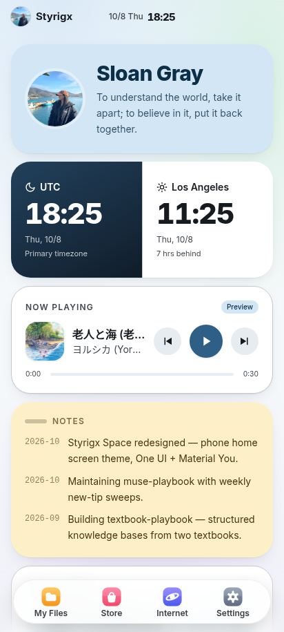
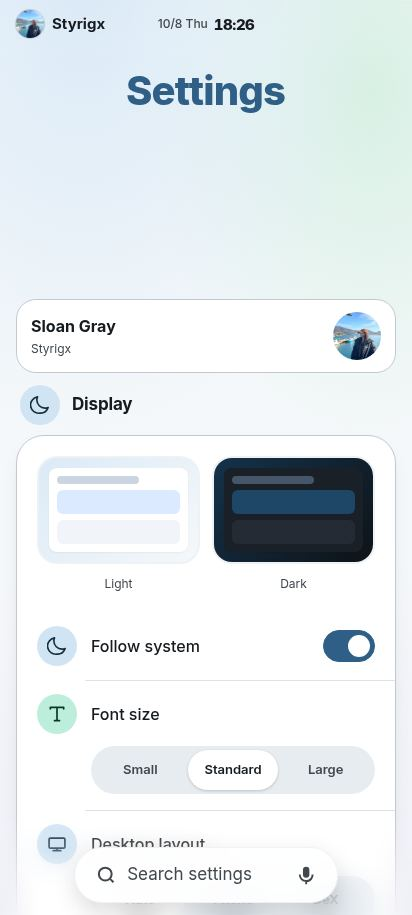
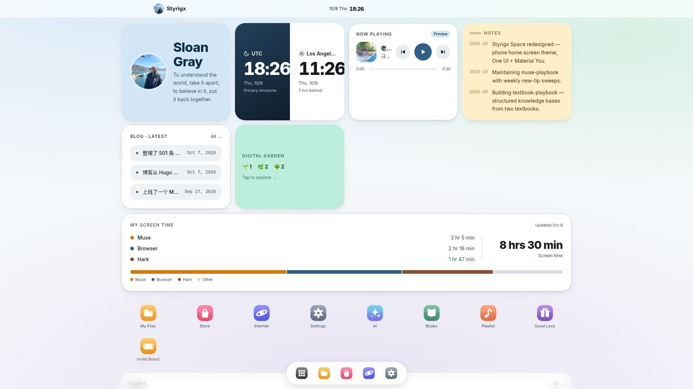

<div align="center">

[中文](README.md) | English

# Styrigx's Space

To understand the world, take it apart; to believe in it, put it back together.

[Visit styrigx.com](https://styrigx.com) · [Blog blog.styrigx.com](https://blog.styrigx.com) · [GitHub @styrigx](https://github.com/styrigx) · [X @styrigx](https://x.com/styrigx)


</div>

---

## What is this

My personal homepage, built to feel like a Samsung phone. Posts and the sites I use live as apps on the home screen. The interface is Styrigx UI, my own take on One UI 9.0, and it works on phone, tablet and DeX.

## Preview

|  |  |
|---|---|
| Home | Settings |


DeX

## Structure

| App | Path | What it is |
|---|---|---|
| Home | `/en/` | Launcher: app icons, widgets and the Dock. Widgets include profile card, dual clocks, weather, Now notes, latest blog posts, digital garden, screen time and collections. |
| My Files | `/en/files/` | Only things I wrote: posts, blog, library. |
| Bookmarks | `/en/bookmarks/` | Moved to the [Curio](https://curio.styrigx.com/en/) subsite on 2026-10-21; the old URL 301s there. |
| Search | Navigation drawer footer | In-place search layer (no page change): recent searches, on-site results, search with your chosen engine; pick the engine in Settings › Security and privacy. Old `/en/search/?q=` links open it on the home page. |
| Settings | `/en/settings/` | Display, language, layout and other system settings, stored locally. |

The Dock only shows on the home screen; inside apps only the search bar stays at the bottom.

## A few Styrigx UI details

- Two layouts: phone (<640px) and DeX (≥640px).
- Light / dark follows the system by default.
- One top bar on every page: nine-dot drawer button | middle capsule with only the current page name (Home on the home page) | quick panel circle; the avatar sits in the drawer head.
- Two full versions: 中文 / English.

## Run locally

Requirements: Hugo extended 0.168.0, Node.js (CI uses 20, needed to build Tailwind).

```bash
git clone https://github.com/styrigx/styrigx-space.git
cd styrigx-space
npm install
npm run build:css
hugo server -s web
```

Open http://localhost:1313 in a browser. Build with `hugo --minify -s web`; output goes to `web/public/`.

Pushing to main auto-deploys to Cloudflare Pages (Pages project `styrigx-space`).

## Directories

The site lives in `web/`, Workers in `workers/`, tests in `tests/`. See [STRUCTURE.md](STRUCTURE.md) (Chinese) for the full layout.

## License

Code is MIT; personal content (posts, images, avatar, etc.) is all rights reserved.

© 2020–2026 Sloan Gray · Powered by Styrigx UI
