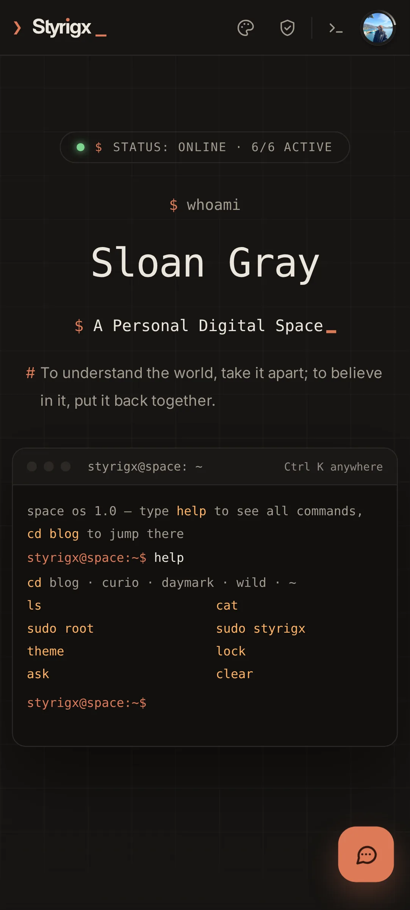
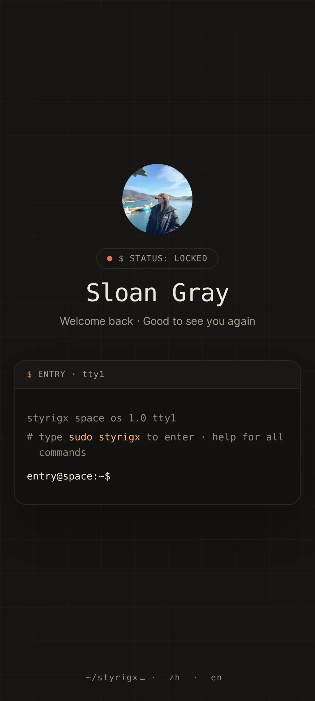
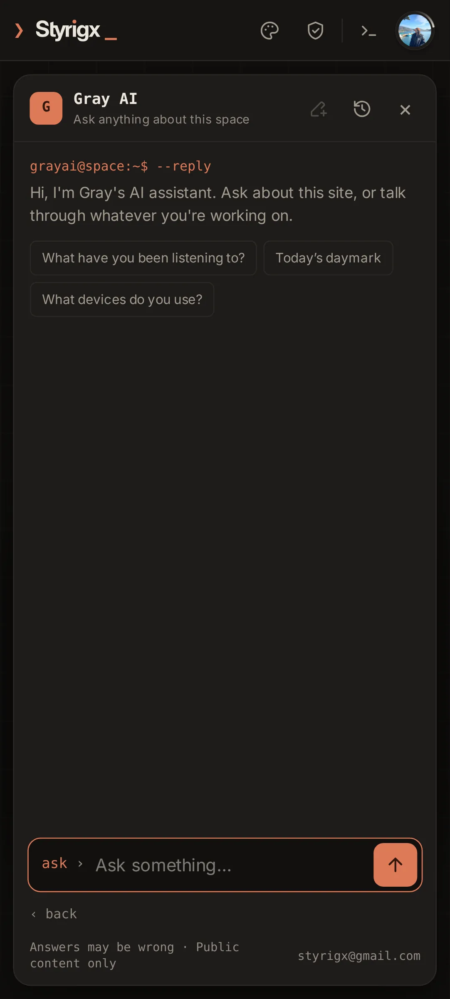
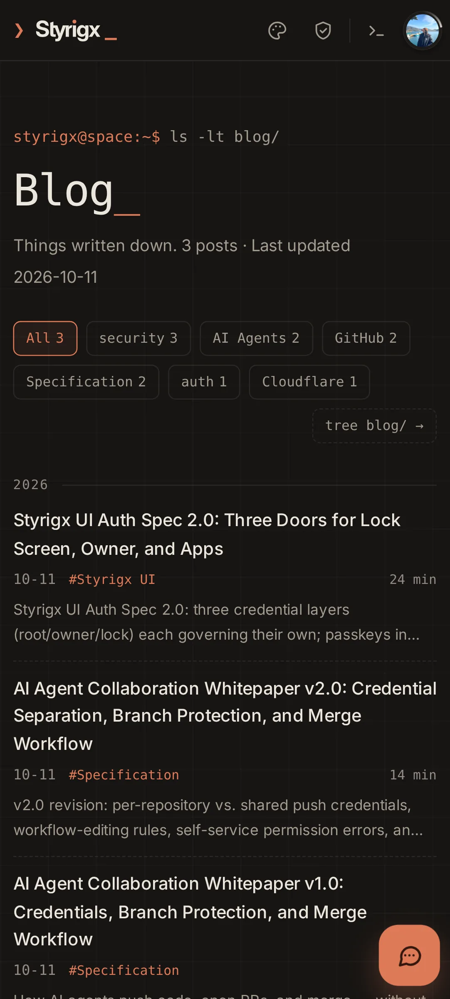
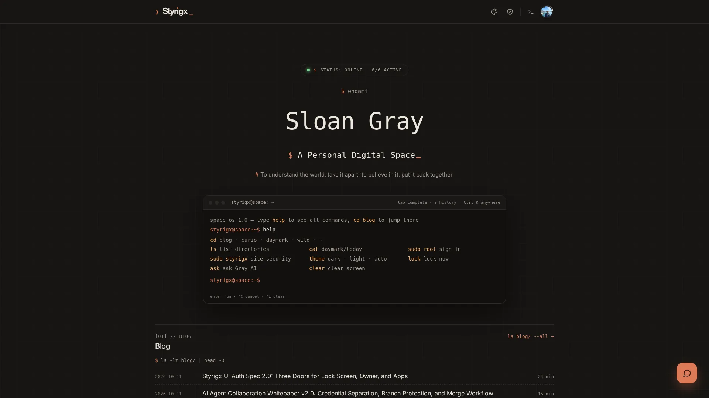
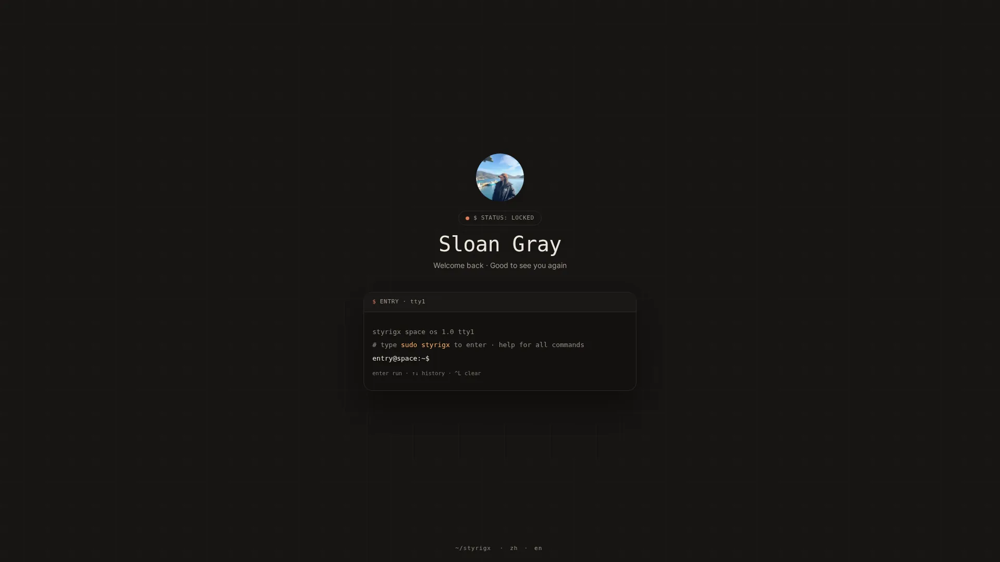
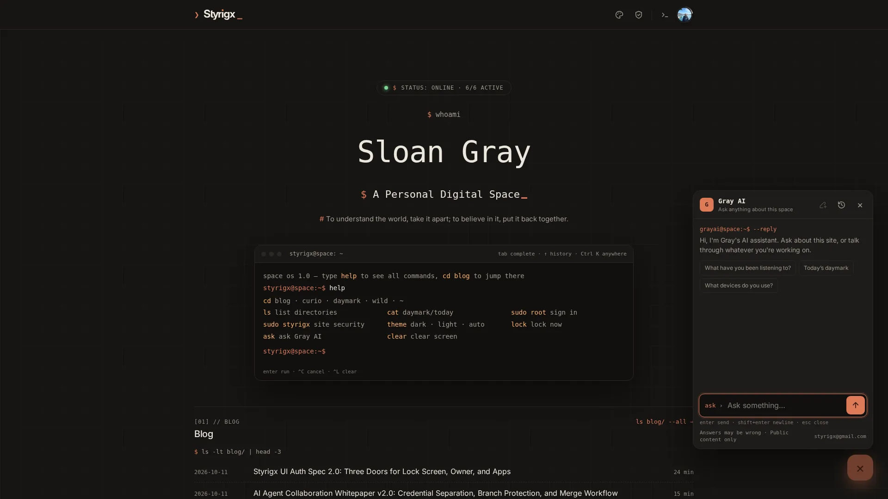
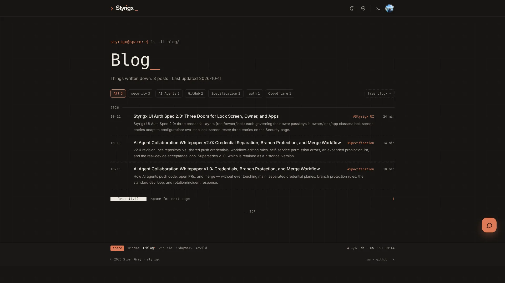

> 已被 v6 定稿取代（见 `docs/decisions/ADR-0006-identity-v6.md`）。

<div align="center">

[中文](README.md) | English

# Styrigx

**A Personal Digital Space**

The personal digital space of Sloan Gray (styrigx): a terminal-style personal website with Blog, Curio, Daymark and a service status page.

[styrigx.com](https://styrigx.com/) · [Blog](https://styrigx.com/blog/) · [GitHub @styrigx](https://github.com/styrigx) · [X @styrigx](https://x.com/styrigx)


</div>

---

## Contents

- [About](#about)
- [Screenshots](#screenshots)
- [Sites and features](#sites-and-features)
- [Tech stack](#tech-stack)
- [Architecture](#architecture)
- [Repository layout](#repository-layout)
- [Local development](#local-development)
- [Testing](#testing)
- [Deployment](#deployment)
- [Documentation](#documentation)
- [License](#license)

## About

This repository holds all of [styrigx.com](https://styrigx.com): one Hugo site (the main site plus three sub-sites) and a set of Cloudflare Workers.

- **Terminal style** — Home, the lock screen, the shield, the account and the AI window all work as "prompt + command + output", with no pop-up dialogs; `Ctrl K` opens the terminal drawer on any page.
- **One site, one build** — the main site and `/blog/`, `/curio/`, `/daymark/` are one Hugo site in one Cloudflare Pages project, sharing one shell (top bar, navigation panel, quick panel, terminal, AI window).
- **Locked by default** — the site is not public. Without a space session every page shows the lock screen first; the owner gets in with an unlock password or a passkey, visitors only with a temporary key or a share link.
- **Bilingual** — English is the default language (`/`), Chinese lives at `/zh/`; light / dark follows the system, with 22 palettes to choose from.

## Screenshots

Dark theme with the default motto. Phone shots use a Samsung phone viewport (412 × 915, Samsung Internet); DeX / desktop shots use the 1920 × 1080 desktop layout. Click an image for full size.

| | Home | Lock screen | AI card | Blog |
|---|---|---|---|---|
| **Phone** | <a href="docs/assets/screenshots/home-mobile-en.webp"></a> | <a href="docs/assets/screenshots/lock-mobile-en.webp"></a> | <a href="docs/assets/screenshots/ai-mobile-en.webp"></a> | <a href="docs/assets/screenshots/blog-mobile-en.webp"></a> |
| **DeX / desktop** | <a href="docs/assets/screenshots/home-dex-en.webp"></a> | <a href="docs/assets/screenshots/lock-dex-en.webp"></a> | <a href="docs/assets/screenshots/ai-dex-en.webp"></a> | <a href="docs/assets/screenshots/blog-dex-en.webp"></a> |

## Sites and features

| Site | Address | What's there |
|---|---|---|
| Home | [`/`](https://styrigx.com/) (Chinese `/zh/`) | Hero (`$ whoami`, name, typed tagline, personal motto) with an embedded terminal; then three sections: latest 3 blog posts, Curio directories, Daymark's quote of the day |
| Status | `/status/` (Chinese `/zh/status/`) | Read-only terminal window: service status, uptime, quota and usage (opened from the STATUS block in the navigation panel; the old `/wild/` redirects here with a 301) |
| Blog | [`/blog/`](https://styrigx.com/blog/) (Chinese `/blog/zh/`) | Posts, a tree of series, tags, RSS |
| Curio | `/curio/` (Chinese `/curio/zh/`) | Finds, devices, games, movies, music |
| Daymark | `/daymark/` (Chinese `/daymark/zh/`) | A collection of quotes and the quote of the day |

Shared by all four sites:

- **AI floating card (Gray AI)** — opened from the bottom-right button; a floating card on phones. It first recalls from the site index (keywords + semantic vectors + read-only Curio queries), then a model streams the answer, rendered as Markdown; conversations stay on the device. The default model is Gemma 4 on Workers AI; a signed-in account can pick GPT-OSS 20B or Gemini ([ADR-0004](docs/decisions/ADR-0004-ai-models.md)).
- **Lock screen (space entry V3)** — a terminal lock screen, `entry@space:~$`, command `sudo styrigx`, unlocked with the unlock password or a passkey; temporary keys and share links work too. The shield in the top bar manages space credentials, temporary keys, share links and lock-now.
- **Account (V3)** — the avatar in the top bar opens the account terminal, signed in with the account password / account passkey. It handles authorization (writing to Curio and Daymark, settings sync, avatar and profile, …) and is a separate set of tickets from space entry: "the door belongs to the site, the account grants permissions" ([SGX-SEC-001](docs/security/account-v3.md)).

## Tech stack

| Layer | What's used |
|---|---|
| Website | [Hugo](https://gohugo.io/) extended (version in [`setup-hugo`](.github/actions/setup-hugo/action.yml)), Tailwind CSS 4, native ES modules (bundled with Hugo `js.Batch`) |
| Hosting | Cloudflare Pages (static files only) |
| Backend | Cloudflare Workers (7), talking over service bindings + RPC |
| Storage | Cloudflare D1, KV, R2, Vectorize, Secrets Store |
| AI | Workers AI (Gemma 4, GPT-OSS 20B, bge-m3 embeddings), Google Gemini API |
| Testing | `node:test` (real SQL on `node:sqlite`), Playwright, Lighthouse CI, stylelint |
| CI / CD | GitHub Actions, Dependabot security updates |

## Architecture

```
browser ──► styrigx.com/*            styrigx-space-core   space session, page gate, share links, API routing
                                       ├─ Pages  styrigx-space (main site + /blog/ /curio/ /daymark/)
                                       ├─ service binding → styrigx-account   account and authorization (no public route)
                                       ├─ service binding → styrigx-ai        on-site AI chat
                                       └─ service binding → styrigx-status    monitoring and usage
        ──► styrigx.com/curio/api/*   styrigx-curio-core    Curio API (D1 + R2)
        ──► styrigx.com/daymark/api/* styrigx-daymark-core  Daymark API (D1)
        ──► proxy-rules.styrigx.com   styrigx-proxy-rules   rule-set accelerating proxy
```

Request paths, Worker responsibilities, front-end / back-end layering and the boundary rules CI enforces: [System overview SGX-ARCH-001](docs/architecture/overview.md).

## Repository layout

```
styrigx-space/
├─ space/
│  ├─ web/       the one Hugo site: main site + sub-sites (kept apart as <dir>/<site>/), output in space/web/public/
│  └─ scripts/   build, generator and static-check scripts (sub-site scripts in scripts/<site>/)
├─ workers/      all Workers, one directory each (directory = Worker name without styrigx-)
├─ tests/        all tests, grouped by what they test
├─ docs/         specifications and ADRs (index: docs/README.md)
└─ .github/      CI workflows, shared composite actions
```

Full details: [SGX-ARCH-002 Repository layout](docs/architecture/repo-structure.md).

## Local development

Requires Node.js 22 (`node:sqlite`) and Hugo extended (version defined in [`.github/actions/setup-hugo/action.yml`](.github/actions/setup-hugo/action.yml)).

```bash
git clone https://github.com/styrigx/styrigx-space.git
cd styrigx-space
npm ci
npm run build:css
hugo server -s space/web     # http://localhost:1313 — main site and /blog/ /curio/ /daymark/ together
```

Locally there is no site core to inject the space session, so pages stay on the lock screen. To just look at the interface, turn the lock off with the test switch (local and CI test builds only; production builds never set it):

```bash
SGX_TEST_NO_LOCK=1 hugo server -s space/web
```

Production build: `npm run build` (CSS + one Hugo run), output in `space/web/public/`. Each Worker's routes, bindings and data are in `workers/<name>/README.md`; the Worker skeleton is defined in [`workers/README.md`](workers/README.md).

## Testing

From the repository root:

```bash
# Unit tests (Workers + main-site front end); run npm run build:css first
node --test tests/workers/space-core/*.test.mjs tests/workers/account/*.test.mjs tests/workers/ai/*.test.mjs \
  tests/workers/status/*.test.mjs tests/workers/proxy-rules/*.test.mjs "tests/space/ui/**/*.test.mjs"

npm run build && npm run test:sites                                   # sub-site unit tests (build first)
npx playwright test --config=tests/config/playwright.config.js        # main-site e2e and visual regression
npx playwright test --config=tests/blog/config/playwright.config.js   # sub-site e2e (same for curio / daymark)

space/scripts/ci-local.sh                     # run the CI groups locally (lighthouse excluded)
space/scripts/ci-local.sh unit build          # only the named groups
```

`ci-local.sh` never touches Cloudflare; the passkey group runs against a local emulator.

## Deployment

GitHub Actions ([`deploy.yml`](.github/workflows/deploy.yml)):

- **Pull requests** — `unit`, `build` (including generated-file `--check`, layering and route checks), `e2e-lock`, `e2e-sites`, `visual`, `lighthouse`, rolled up into `quality`; plus `passkey-e2e`. Both must be green and the branch up to date with `main` before merging; merge commits only.
- **main** — Workers deploy in dependency order (AI, status, account → site core → Curio / Daymark APIs; the rule-set proxy in parallel), Pages last; every step has post-deploy checks and a smoke test, and rolls back to the pre-deploy version on failure.
- Every deploy job uses its own least-privilege deploy token, kept in a GitHub environment restricted to `main`; the repository holds no secrets.

Details: [SGX-OPS-001 CI and deployment](docs/operations/deploy.md).

## Documentation

The specifications live in [`docs/`](docs/README.md) (written in Chinese); the index is [docs/README.md](docs/README.md). Good starting points:

| Document | What it covers |
|---|---|
| [Glossary](docs/glossary.md) | Site, space-entry and account terms |
| [System overview](docs/architecture/overview.md) | Request paths, Worker responsibilities, layering rules |
| [Main site](docs/architecture/sites/space.md) · [Blog](docs/architecture/sites/blog.md) · [Curio and Daymark](docs/architecture/sites/curio-daymark.md) | Pages and code locations per site |
| [Terminal-style UI system](docs/design/ui-system.md) · [Palette](docs/design/palette.md) | Interface rules |
| [CI and deployment](docs/operations/deploy.md) | Check jobs, deploy order, rollback |
| [PRs and commits](docs/contributing/pr-and-commits.md) · [Writing posts](docs/contributing/blog-writing.md) | Contribution conventions |
| [ADR-0001](docs/decisions/ADR-0001-one-repo-one-site.md) · [ADR-0002](docs/decisions/ADR-0002-lock-screen.md) · [ADR-0003](docs/decisions/ADR-0003-account-v3.md) · [ADR-0004](docs/decisions/ADR-0004-ai-models.md) | Decision records: one site, lock screen, account V3, AI models |

## License

Code is released under the [MIT](LICENSE) license; posts, images, avatars and other personal content are all rights reserved.

<p align="center">© 2020–2026 Sloan Gray</p>
