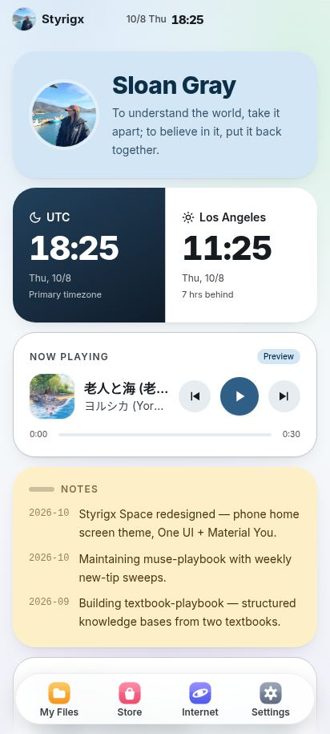
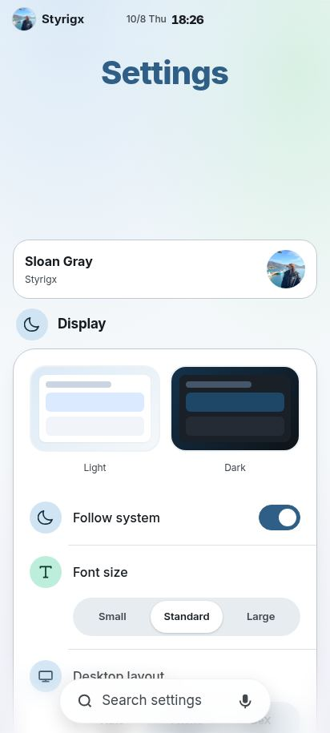
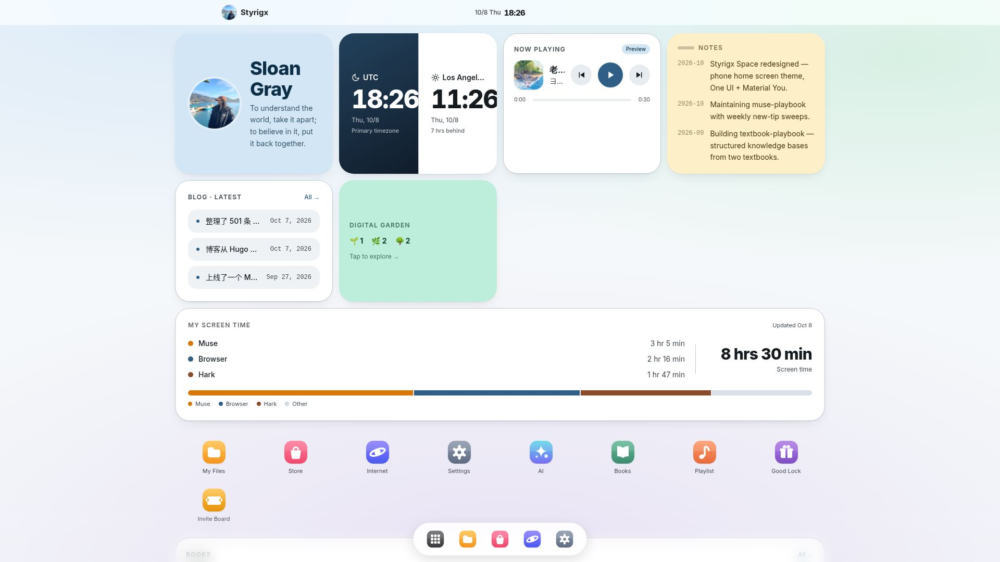
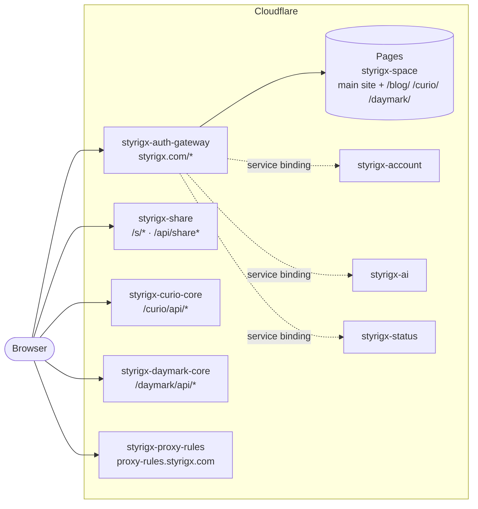

<div align="center">

[中文](README.md) | English

# Styrigx's Space

**To understand the world, take it apart; to believe in it, put it back together.**

Sloan Gray's personal portal — Space and Account — and the auth gateway that guards the whole site family.

[styrigx.com](https://styrigx.com) · [Blog styrigx.com/blog/](https://styrigx.com/blog/) · [GitHub @styrigx](https://github.com/styrigx) · [X @styrigx](https://x.com/styrigx)


</div>

---

## Contents

- [Overview](#overview)
- [Preview](#preview)
- [Apps](#apps)
- [Architecture](#architecture)
- [Security model](#security-model)
- [Styrigx UI](#styrigx-ui)
- [Local development](#local-development)
- [Testing and CI](#testing-and-ci)
- [Repository layout](#repository-layout)
- [Site family](#site-family)
- [License](#license)

## Overview

This is the source of styrigx.com and the "system" repository of the site family:

- **Portal** — Space (the single top-level page) and Account, fully bilingual.
- **Auth gateway** — every page and API on the main site and on the sub-sites (Blog, Curio, Daymark at `styrigx.com/<site>/`) goes through it first. The whole site is locked by design; sharing only happens through short links that carry a temporary key.
- **Shared shell** — the top bar, navigation drawer and search layer are generated here; each sub-site keeps a synced copy pinned to a shell version (git tree hash).
- **Shared CI** — Hugo, Node and Playwright setup are published as composite actions (`v*` tags) that Atlas references by tag.

The interface is **Styrigx UI**, built in-house, with version numbers that track One UI; the **SGX** kernel handles sign-in and sessions. It works on phone, tablet and DeX, and feels much like a Samsung phone.

## Preview

|  |  |
|:---:|:---:|
| Space (top) | Space category entries |


<p align="center">DeX</p>

## Apps

| App | Path | What it does |
|---|---|---|
| Space | `/` (Chinese `/zh/`) | The main site's only top-level page (Home and Settings merged): profile card, Daymark's quote of the day, screen time, then every category laid out below — Style `/theme/`, Security `/security/` (lock credentials `/security/lock/`, temporary keys `/security/tempkeys/`), Digital wellbeing `/wellbeing/`, Service status `/status/`, About `/about/`. Settings are stored locally and synced once you sign in; service status shows uptime and incidents for the main site, Proxy rules and AI; temporary keys include share links, and creating or revoking one asks for a lock re-verification. |
| AI assistant | Top-bar AI button | On-site assistant: recalls from the site-wide index, then a model (self-hosted Gemma 4 / GPT-OSS 20B, or external Gemini) streams the answer with on-site source cards; the conversation stays local. |
| Account | `/account/` | Opened from the avatar in the drawer head: account sign-in, cloud sync, devices, account security. |

## Architecture



| Worker | Responsibility | Entry |
|---|---|---|
| `styrigx-auth-gateway` | Issues and verifies lock sessions, lock credentials and temporary-key APIs; checks the session on every page (including the `/blog/`, `/curio/`, `/daymark/` sub-sites) before serving it from Pages | `styrigx.com/*` |
| `styrigx-account` | Account system: password, passkeys, devices, account root key, avatar, cloud sync, digital wellbeing | Gateway service binding only, no public route |
| `styrigx-share` | Share short links and their management API | `styrigx.com/s/*`, `styrigx.com/api/share*` |
| `styrigx-ai` | On-site assistant: KV index recall + model answer (Workers AI / Gemini); stores nothing | Gateway service binding only |
| `styrigx-status` | Checks every minute, reads usage hourly (D1) | Gateway service binding only |
| `styrigx-proxy-rules` | Accelerating proxy for rule sets, allow-listed upstream only | `proxy-rules.styrigx.com` (bypasses the gateway) |
| `styrigx-curio-core` | Curio API (D1 + R2) | `styrigx.com/curio/api/*` (more specific than the gateway) |
| `styrigx-daymark-core` | Daymark API (D1) | `styrigx.com/daymark/api/*` (same) |

The sub-sites and the main site are one tree in a single Pages project (main site at the root, the three sites under `/blog/`, `/curio/`, `/daymark/`), deployed together.

## Security model

- **Locked by default** — pages and APIs check the lock session first; signed-out page requests get a 302 to the lock screen, APIs get 401.
- **Separation of duties** — the lock (gateway) and the account (account Worker) have their own storage, keys and root keys, and never import each other's code (enforced in CI by `check-layers`).
- **Minimal exposure** — account, chat, search and status have no public routes and are reachable only through the gateway's service bindings; the gateway strips any forged identity headers from outside.
- **Key handling** — secrets live only in Cloudflare Secrets Store and per-Worker secrets, never in the repo; each Worker deploys with its own least-privilege token, stored in a GitHub environment restricted to `main`.
- **In the browser** — strict CSP (inline scripts allowed by hash, generated by `gen-csp` and verified in CI), HSTS, `nosniff`.
- **Sharing** — only through time-limited short links (each backed by a temporary key); creating one asks for a lock re-verification, and any link can be revoked at any time.

Design details: [docs/architecture.md](docs/architecture.md), [docs/auth-state-machine.md](docs/auth-state-machine.md).

## Styrigx UI

- Three layouts, Mobile · Auto · DeX: on Auto, landscape viewports at least 840 wide and 500 tall get DeX, everything else gets Mobile (viewport only, no device sniffing).
- Sizes scale smoothly on wide screens: margins and top-bar buttons grow with the width; the top bar and the page share one frame (up to 1440 on DeX, 640 for Mobile on wide portrait screens); Home cards use 2–3 columns, never narrower than 320.
- Light / dark follows the system by default.
- One top bar everywhere: nine-dot drawer button, a capsule showing only the current page name, the quick panel; on Space the capsule shows its single top-level tab.
- Two complete versions: 中文 / English.

## Local development

Requirements: Node.js ≥ 22, Hugo extended (version defined in [`.github/actions/setup-hugo/action.yml`](.github/actions/setup-hugo/action.yml)).

```bash
git clone https://github.com/styrigx/styrigx-space.git
cd styrigx-space
npm ci
npm run build:css
hugo server -s space/web          # http://localhost:1313
```

Production build: `hugo --minify -s space/web`, output in `space/web/public/`. Each Worker's README explains how to run it locally.

## Testing and CI

| Layer | What runs |
|---|---|
| Unit | `node --test` across all Workers and front-end modules; auth code runs real SQL on `node:sqlite` |
| Page | Playwright end-to-end flows (lock screen, credentials, account, navigation, layout) plus visual regression baselines |
| Static | Generated-file consistency (shell, CSP, palettes, cookie contract), Worker route registry, front-end layering, stylelint |
| passkey-e2e | Full passkey flow against real Workers in a preview environment |

Pull requests must pass `quality` and `passkey-e2e` (squash-only, linear history). Merging to `main` deploys Pages and the 9 Workers, in the order API Workers (including Curio and Daymark) → gateway → Pages; every deploy is followed by a smoke check and rolls back to the previous version on failure, and search and chat also sit behind a health gate fed by the status monitor. Dependencies are updated weekly by Renovate.

## Repository layout

```
styrigx-space/
├─ space/      main site + infrastructure: web/ is the main site (Hugo, published by Cloudflare Pages); scripts/ holds build, generators and static checks
├─ atlas/      subsites: web/blog/ web/curio/ web/daymark/; scripts/<site>/ holds each subsite's own scripts
├─ workers/    all Workers, one directory each
├─ tests/      tests, grouped by what they test
├─ docs/       design docs, task specs and screenshots (index: docs/README.md)
└─ .github/    CI workflows and shared composite actions
```

Full details in [STRUCTURE.md](STRUCTURE.md) (Chinese).

## Site family

| Repository | Address | What |
|---|---|---|
| **styrigx-space** (this repo) | [styrigx.com](https://styrigx.com) | Portal and auth gateway; sub-sites [Blog](https://styrigx.com/blog/), [Curio](https://styrigx.com/curio/), [Daymark](https://styrigx.com/daymark/) (merged in from styrigx-atlas, 2026-11) |

The old Atlas domain's 301 redirect was removed in 2026-11 (P4-3 PR-1); the domain is retired.

## License

Code is released under the [MIT](LICENSE) license; posts, images, avatars and other personal content are all rights reserved.

<p align="center">© 2020–2026 Sloan Gray · Powered by Styrigx UI</p>
