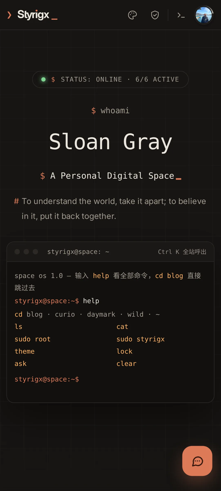
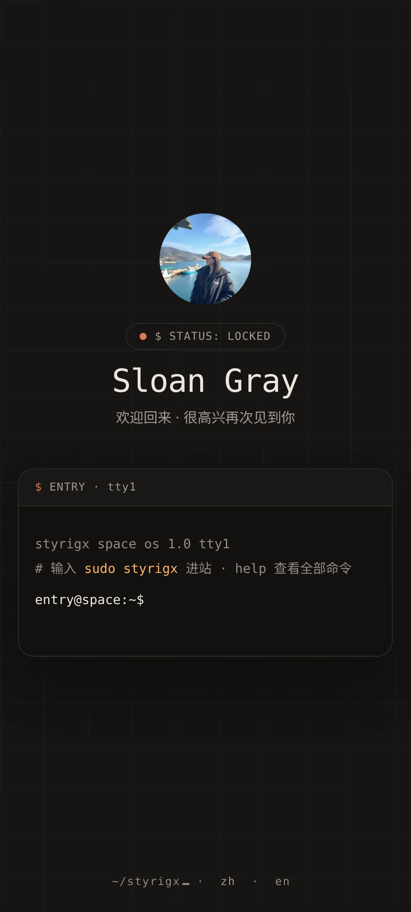
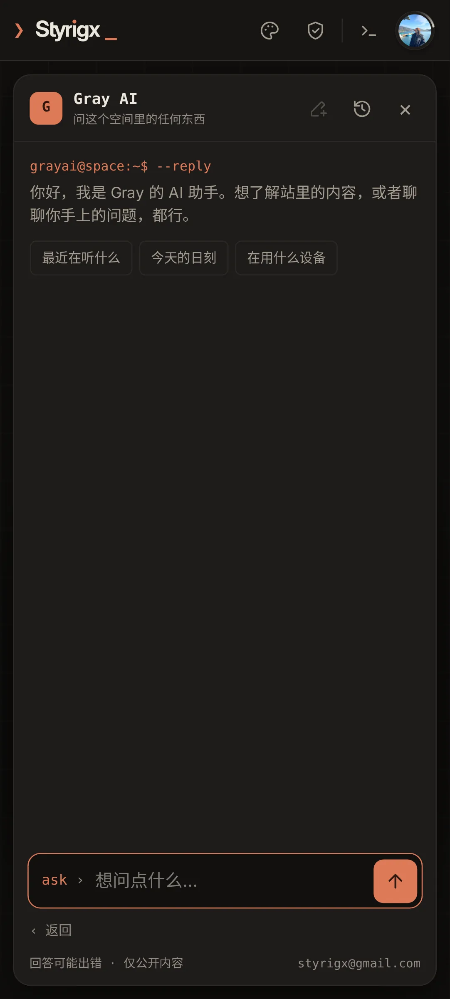
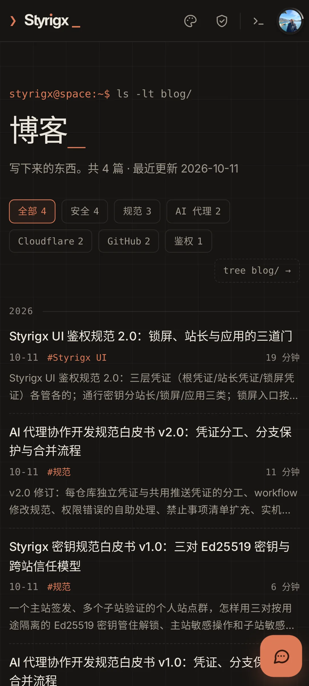
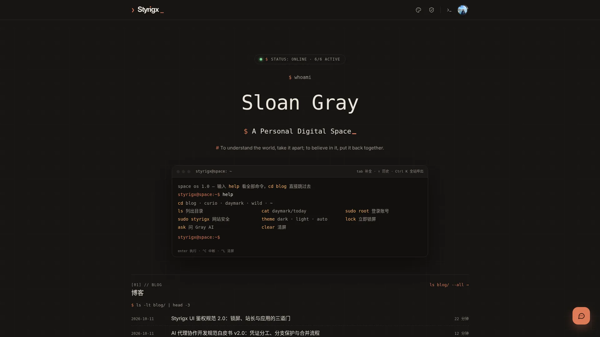
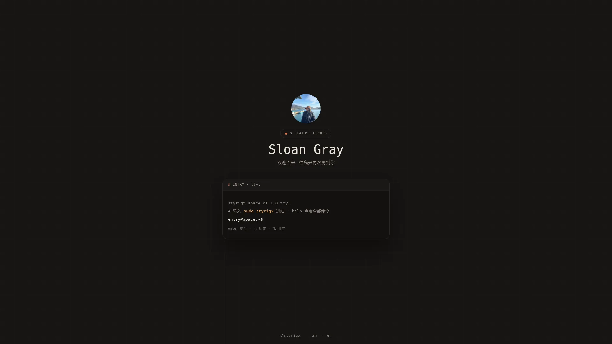
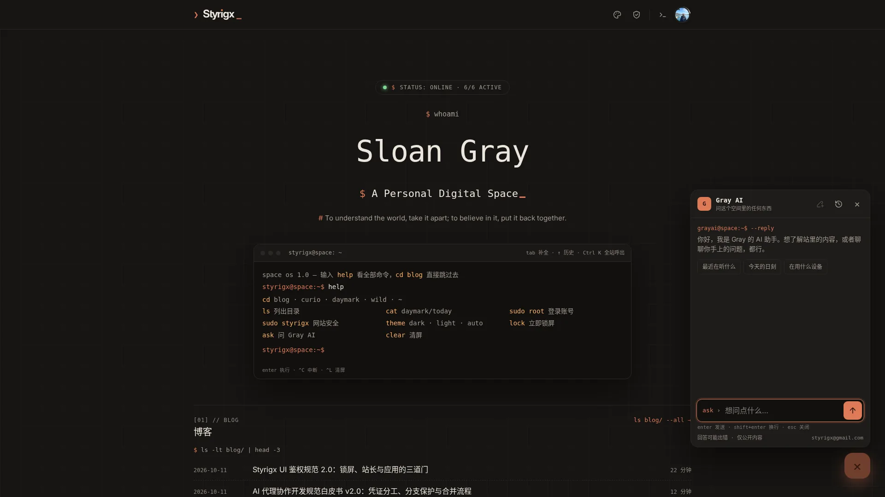
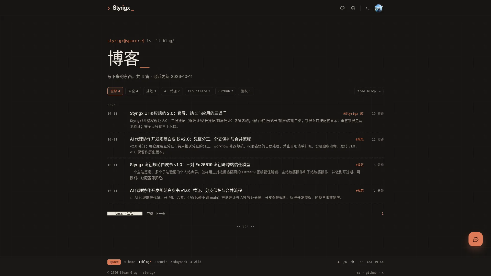

<div align="center">

中文 | [English](README.en.md)

# Styrigx

**A Personal Digital Space**

Sloan Gray（styrigx）的个人数字空间：一个终端风格的个人网站，带博客、奇趣、日刻、旷野几个子站。

[styrigx.com](https://styrigx.com/zh/) · [博客](https://styrigx.com/blog/zh/) · [GitHub @styrigx](https://github.com/styrigx) · [X @styrigx](https://x.com/styrigx)


</div>

---

## 目录

- [简介](#简介)
- [截图](#截图)
- [站点与功能](#站点与功能)
- [技术栈](#技术栈)
- [架构](#架构)
- [仓库结构](#仓库结构)
- [本地开发](#本地开发)
- [测试](#测试)
- [部署](#部署)
- [文档](#文档)
- [许可](#许可)

## 简介

本仓库是 [styrigx.com](https://styrigx.com) 的全部源码：一个 Hugo 站点（主站 + 三个子站）加上一组 Cloudflare Worker。

- **终端风格**：首页、锁屏、盾牌、账号、AI 窗都用「提示符 + 命令 + 输出」的形式交互，没有弹层；任意页 `Ctrl K` 打开终端抽屉。
- **一个站，一次构建**：主站和 `/blog/`、`/curio/`、`/daymark/` 是同一个 Hugo 站、同一个 Cloudflare Pages 项目，共用同一套外壳（顶栏、导航面板、快捷面板、终端、AI 窗）。
- **默认上锁**：网站不公开。没有进站会话时任何页面都先出锁屏；拥有者用解锁密码或通行密钥（passkey）进站，访客只能凭临时钥匙或分享链接进入。
- **中英双语**：英文为默认语言（`/`），中文在 `/zh/`；浅色 / 深色跟随系统，22 套调色板可选。

## 截图

深色主题，默认个人签名；手机为三星手机视口（412 × 915，三星浏览器），DeX / 桌面为 1920 × 1080 的桌面布局。点图看原图。

| | 首页 | 锁屏 | AI 浮窗 | 博客 |
|---|---|---|---|---|
| **手机** | <a href="docs/assets/screenshots/home-mobile-zh.webp"></a> | <a href="docs/assets/screenshots/lock-mobile-zh.webp"></a> | <a href="docs/assets/screenshots/ai-mobile-zh.webp"></a> | <a href="docs/assets/screenshots/blog-mobile-zh.webp"></a> |
| **DeX / 桌面** | <a href="docs/assets/screenshots/home-dex-zh.webp"></a> | <a href="docs/assets/screenshots/lock-dex-zh.webp"></a> | <a href="docs/assets/screenshots/ai-dex-zh.webp"></a> | <a href="docs/assets/screenshots/blog-dex-zh.webp"></a> |

## 站点与功能

| 站点 | 地址 | 内容 |
|---|---|---|
| 主页 | [`/zh/`](https://styrigx.com/zh/)（英文 `/`） | hero（`$ whoami`、名字、打字轮播的标语、个人签名）+ 内嵌终端；下面四节：博客最新 3 篇、奇趣目录、日刻今日一句、旷野小卡 |
| 旷野 | `/zh/wild/`（英文 `/wild/`） | 三个只读终端窗：`#screen-time` 屏幕时间、`#status` 服务状态与用量、`#about` 版本信息 |
| 博客 | [`/blog/zh/`](https://styrigx.com/blog/zh/)（英文 `/blog/`） | 文章、专题树形目录、标签、RSS |
| 奇趣 | `/curio/zh/`（英文 `/curio/`） | 发现、设备、游戏、电影、音乐 |
| 日刻 | `/daymark/zh/`（英文 `/daymark/`） | 句子收藏与「今日一句」 |

四站共用的外壳：

- **AI 浮窗（Gray AI）**：右下浮钮打开，手机上是悬浮卡。先在站内索引里召回（关键词 + 语义向量 + 奇趣只读查询），再交给模型流式回答，Markdown 渲染；对话只存在本地。默认模型是 Workers AI 上的 Gemma 4，已登录账号可改选 GPT-OSS 20B 或 Gemini（[ADR-0004](docs/decisions/ADR-0004-ai-models.md)）。
- **锁屏（进站 V3）**：终端锁屏 `entry@space:~$`，命令 `sudo styrigx`，用解锁密码或通行密钥进站；也接受临时钥匙与分享链接。顶栏盾牌管理进站凭证、临时钥匙、分享链接和立即锁屏。
- **账号（V3）**：顶栏头像打开账号终端，账号密码 / 账号通行密钥登录；负责授权（写奇趣、日刻、设置云同步、头像与个人资料等），和进站是两套独立的票据——「门归网站，账号管授权」（[SGX-SEC-001](docs/security/account-v3.md)）。

## 技术栈

| 层 | 用到的 |
|---|---|
| 网站 | [Hugo](https://gohugo.io/) extended（版本见 [`setup-hugo`](.github/actions/setup-hugo/action.yml)）、Tailwind CSS 4、原生 ES 模块（Hugo `js.Batch` 打包） |
| 托管 | Cloudflare Pages（只放静态文件） |
| 后端 | Cloudflare Workers（7 个），服务绑定 + RPC 互相调用 |
| 存储 | Cloudflare D1、KV、R2、Vectorize、Secrets Store |
| AI | Workers AI（Gemma 4、GPT-OSS 20B、bge-m3 向量）、Google Gemini API |
| 测试 | `node:test`（含 `node:sqlite` 跑真实 SQL）、Playwright、Lighthouse CI、stylelint |
| CI / CD | GitHub Actions、Renovate |

## 架构

```
浏览器 ──► styrigx.com/*            styrigx-space-core   进站会话、页面关口、分享链接、接口路由
                                       ├─ Pages  styrigx-space（主站 + /blog/ /curio/ /daymark/）
                                       ├─ 服务绑定 → styrigx-account   账号与授权（无公开路由）
                                       ├─ 服务绑定 → styrigx-ai        站内 AI 对话
                                       └─ 服务绑定 → styrigx-status    监测与用量
       ──► styrigx.com/curio/api/*   styrigx-curio-core    奇趣接口（D1 + R2）
       ──► styrigx.com/daymark/api/* styrigx-daymark-core  日刻接口（D1）
       ──► proxy-rules.styrigx.com   styrigx-proxy-rules   规则集加速反代
```

请求路径、Worker 分工、前后端分层和 CI 守住的边界规则见 [系统总览 SGX-ARCH-001](docs/architecture/overview.md)；cookie 与进站状态机见 [SGX-SPEC-001](docs/specs/auth-state-machine.md)。

## 仓库结构

```
styrigx-space/
├─ space/
│  ├─ web/       唯一的 Hugo 站：主站 + 子站（子站按 <目录>/<站>/ 分开），产物 space/web/public/
│  └─ scripts/   构建、生成、静态检查脚本（子站自己的在 scripts/<站>/）
├─ workers/      全部 Worker，一个目录一个（目录名 = Worker 名去掉 styrigx-）
├─ tests/        全部测试，按对象分目录
├─ docs/         规范书与 ADR（入口 docs/README.md）
└─ .github/      CI 工作流、共享 composite action、Renovate 配置
```

完整说明见 [SGX-ARCH-002 仓库结构](docs/architecture/repo-structure.md)。

## 本地开发

需要 Node.js 22（`node:sqlite`）和 Hugo extended（版本以 [`.github/actions/setup-hugo/action.yml`](.github/actions/setup-hugo/action.yml) 为准）。

```bash
git clone https://github.com/styrigx/styrigx-space.git
cd styrigx-space
npm ci
npm run build:css
hugo server -s space/web     # http://localhost:1313 ，主站与 /blog/ /curio/ /daymark/ 一起
```

本地没有站点核心注入进站状态，页面会停在锁屏；只看界面时用测试开关关掉锁屏（只用于本地与 CI 测试构建，生产构建绝不设置）：

```bash
SGX_TEST_NO_LOCK=1 hugo server -s space/web
```

生产构建：`npm run build`（CSS + 一次 Hugo），产物在 `space/web/public/`。各 Worker 的路由、绑定与数据见 `workers/<名字>/README.md`，骨架约定见 [`workers/README.md`](workers/README.md)。

## 测试

在仓库根目录运行：

```bash
# 单元测试（Worker + 主站前端），先 npm run build:css
node --test tests/workers/space-core/*.test.mjs tests/workers/account/*.test.mjs tests/workers/ai/*.test.mjs \
  tests/workers/status/*.test.mjs tests/workers/proxy-rules/*.test.mjs "tests/space/ui/**/*.test.mjs"

npm run build && npm run test:sites                                   # 子站单测（先构建）
npx playwright test --config=tests/config/playwright.config.js        # 主站 e2e 与视觉回归
npx playwright test --config=tests/blog/config/playwright.config.js   # 子站 e2e（curio / daymark 同理）

space/scripts/ci-local.sh                     # 按 CI 分组跑一遍（不含 lighthouse）
space/scripts/ci-local.sh unit build          # 只跑指定分组
```

`ci-local.sh` 不连 Cloudflare，passkey 组走本地模拟器。

## 部署

GitHub Actions（[`deploy.yml`](.github/workflows/deploy.yml)）：

- **PR**：`unit`、`build`（含生成物 `--check`、分层与路由检查）、`e2e-lock`、`e2e-sites`、`visual`、`lighthouse`，汇总为 `quality`；另有 `passkey-e2e`。两项都绿、分支与 `main` 同步后才能合并，只允许 squash。
- **main**：按依赖顺序部署 Worker（AI、监测、账号 → 站点核心 → 奇趣 / 日刻接口；规则集反代并行），最后部署 Pages；每一步都有部署后核对与冒烟，失败自动回滚到部署前的版本。
- 每个部署作业使用各自最小权限的部署令牌，放在只允许 `main` 使用的 GitHub environment 里；仓库里没有任何密钥。

细节见 [SGX-OPS-001 CI 与部署](docs/operations/deploy.md)。

## 文档

规范书在 [`docs/`](docs/README.md)，索引见 [docs/README.md](docs/README.md)。常用入口：

| 文档 | 内容 |
|---|---|
| [术语表](docs/glossary.md) | 站点、进站、账号相关术语 |
| [系统总览](docs/architecture/overview.md) | 请求路径、Worker 分工、分层规则 |
| [主站](docs/architecture/sites/space.md) · [博客](docs/architecture/sites/blog.md) · [奇趣与日刻](docs/architecture/sites/curio-daymark.md) | 各站页面与代码位置 |
| [进站与账号安全模型 V3](docs/security/account-v3.md) | 凭证、会话时长、reauth / reset |
| [终端风格 UI 系统](docs/design/ui-system.md) · [调色板](docs/design/palette.md) | 界面规则 |
| [CI 与部署](docs/operations/deploy.md) | 检查作业、部署顺序、回滚 |
| [PR 与提交](docs/contributing/pr-and-commits.md) · [写博客](docs/contributing/blog-writing.md) | 贡献约定 |
| [ADR-0001](docs/decisions/ADR-0001-one-repo-one-site.md) · [ADR-0002](docs/decisions/ADR-0002-lock-screen.md) · [ADR-0003](docs/decisions/ADR-0003-account-v3.md) · [ADR-0004](docs/decisions/ADR-0004-ai-models.md) | 合站、锁屏、账号 V3、AI 模型的决策记录 |

## 许可

代码以 [MIT](LICENSE) 许可发布；文章、图片、头像等个人内容保留所有权利。

<p align="center">© 2020–2026 Sloan Gray</p>
