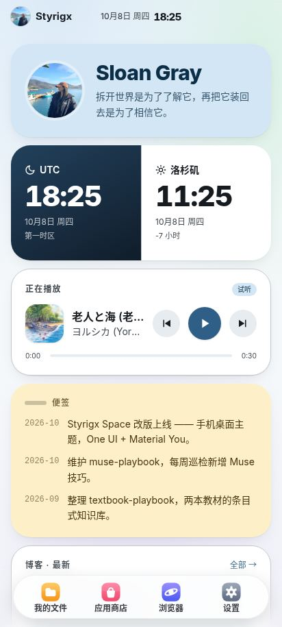
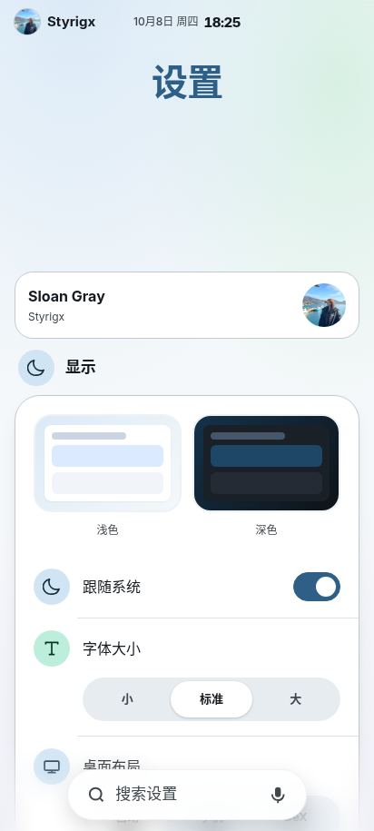
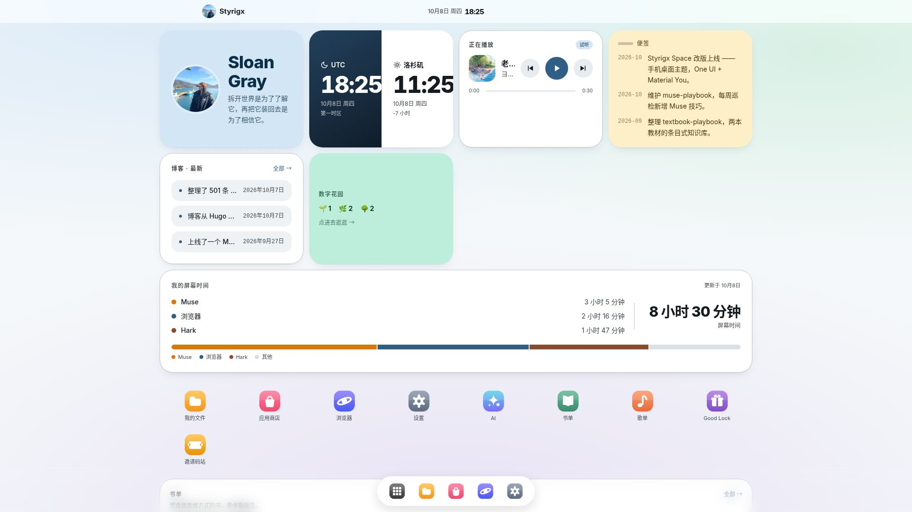

<div align="center">

中文 | [English](README.en.md)

# Styrigx's Space

拆开世界是为了了解它，再把它装回去是为了相信它。

[在线访问 styrigx.com](https://styrigx.com) · [博客 blog.styrigx.com](https://blog.styrigx.com) · [GitHub @styrigx](https://github.com/styrigx) · [X @styrigx](https://x.com/styrigx)


</div>

---

## 这是什么

这是 Sloan Gray 的个人门户，也是他的互联网净土：主页、聊天、设置和账号都在这里；文章在博客子站，收藏在奇趣，日刻在日刻子站，四站同一套界面。全站上锁是设计本身——分享只用带访客密钥的短链。

界面是自研的 Styrigx UI（版本号与 One UI 对齐，现为 9.0），内核是管登录与会话的 SGX；手机、平板和 DeX 都能打开，长得像一台三星手机。

## 预览

|  |  |
|---|---|
| 手机主页 | 设置 |


DeX

## 结构

| 应用 | 路径 | 是什么 |
|---|---|---|
| 主页 | `/` | 顶栏三栏之一：名片、双时钟、天气、日刻每日一句和屏幕时间几张卡片。 |
| 搜索 | 导航抽屉底栏 | 原地搜索层（不跳页）：站内结果、用所选搜索引擎搜索；搜索引擎在 设置 › 安全与隐私 里选。旧地址 `/search/?q=` 转到首页并打开搜索层。 |
| 聊天 | `/chat/` | 顶栏三栏之一：联网检索问答（仅管理员；Gemini 2.5 Flash + Google 搜索接地，`/api/chat` 由网关验完会话转给聊天 Worker `styrigx-chat` 流式回答，附来源），对话只存在本标签页，关掉就清。 |
| 设置 | `/settings/` | 顶栏三栏之一：显示、语言、布局等系统设置，偏好存在本地（登录账号后可云同步）。 |
| 账号 | `/account/` | 导航抽屉头的头像进入（仅管理员）：账号登录、服务状态（主站、博客、日刻、奇趣、规则集的当前状态、延迟、90 天可用率和近期故障，`/api/status`，每分钟刷新）、云同步、设备、临时钥匙、账号安全。 |

## Styrigx UI 的几个细节

- 布局三档 Mobile · Auto · DeX：自动时横屏且宽 ≥ 840、高 ≥ 500 用 DeX，其余用 Mobile（只看视口，不看设备）。
- 宽屏尺寸连续变化：页边距、顶栏按钮随宽度平滑放大；顶栏和每页的外框是同一个框（DeX 最宽 1440、宽竖屏 Mobile 640），内容列在框里居中，首页卡片 2～3 列、每列不窄于 320，天气 / 日刻没数据时剩下的卡铺满那一行。
- 浅色 / 深色默认跟随系统。
- 全站同一条顶栏：九宫格（导航抽屉）| 中间长条只显示当前页名 | 右圆快捷面板；头像在导航抽屉头。主页 / 聊天 / 设置三页的长条是这三页的标签（只在主站）。
- 中文 / English 两套页面。

## 本地运行

环境要求：Hugo extended 0.168.0、Node.js（CI 用 22，构建 Tailwind 需要）。

```bash
git clone https://github.com/styrigx/styrigx-space.git
cd styrigx-space
npm ci
npm run build:css
hugo server -s web
```

浏览器打开 http://localhost:1313。构建用 `hugo --minify -s web`，产物在 `web/public/`。

推送 main 后自动部署到 Cloudflare Pages（Pages 项目名 `styrigx-space`）。

## 目录说明

网站本体在 `web/`，Worker 在 `workers/`，测试在 `tests/`。完整说明见 [STRUCTURE.md](STRUCTURE.md)。

## 许可

代码 MIT；文章、图片、头像等个人内容保留所有权利。

© 2020–2026 Sloan Gray · Powered by Styrigx UI
