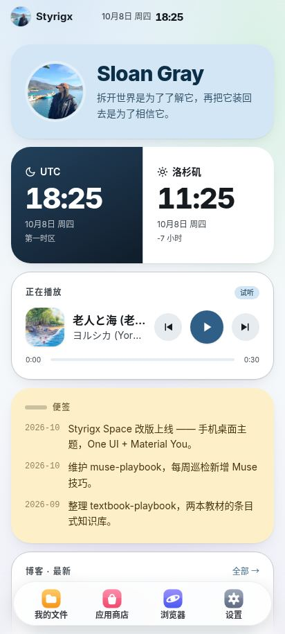
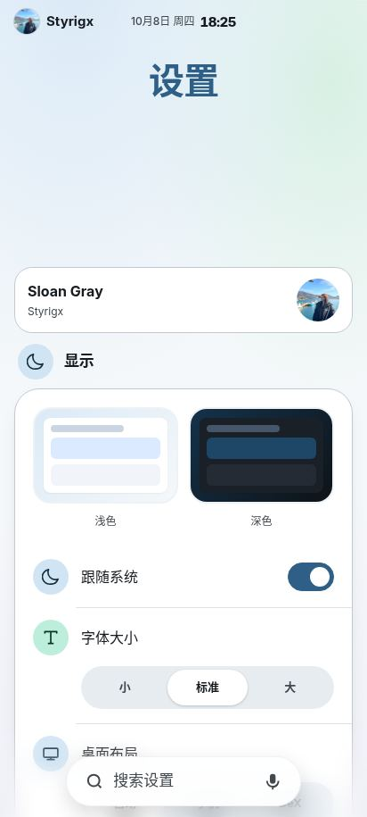
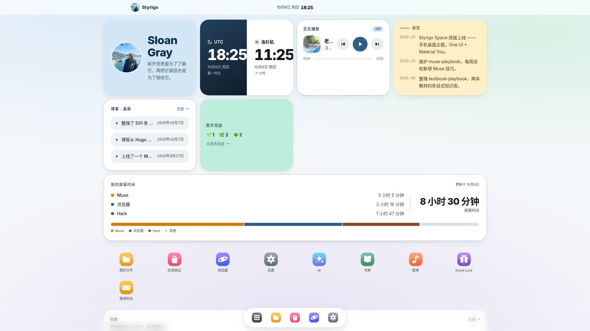
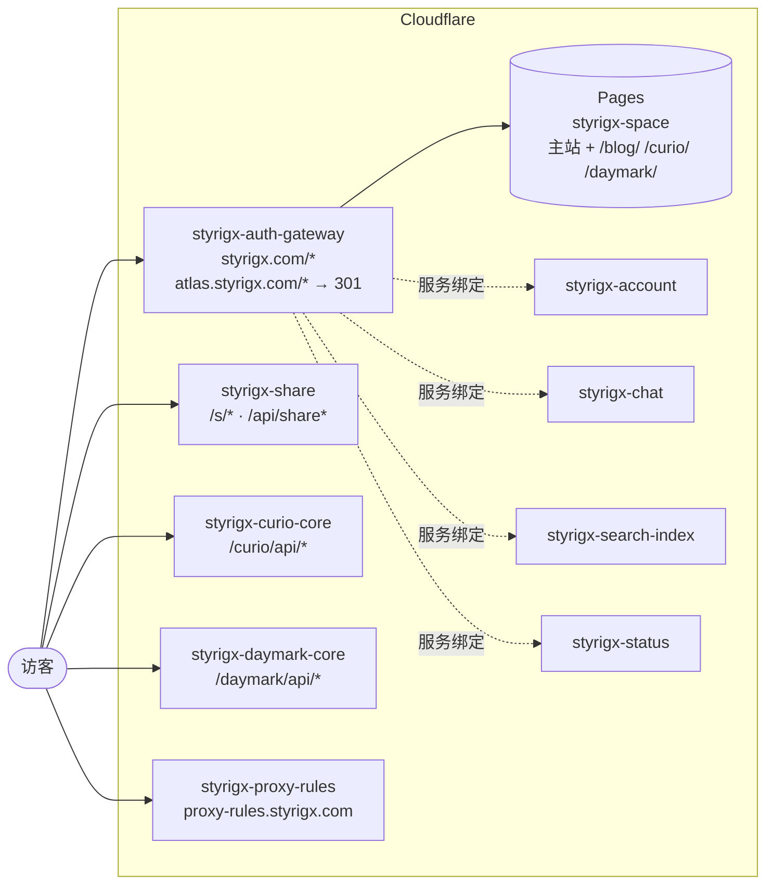

<div align="center">

中文 | [English](README.en.md)

# Styrigx's Space

**拆开世界是为了了解它，再把它装回去是为了相信它。**

Sloan Gray 的个人门户：主页、聊天、设置与账号，以及守住整个站点家族的鉴权网关。

[styrigx.com](https://styrigx.com) · [博客 styrigx.com/blog/](https://styrigx.com/blog/) · [GitHub @styrigx](https://github.com/styrigx) · [X @styrigx](https://x.com/styrigx)


</div>

---

## 目录

- [概览](#概览)
- [预览](#预览)
- [应用](#应用)
- [架构](#架构)
- [安全模型](#安全模型)
- [Styrigx UI](#styrigx-ui)
- [本地开发](#本地开发)
- [测试与 CI](#测试与-ci)
- [仓库结构](#仓库结构)
- [站点家族](#站点家族)
- [许可](#许可)

## 概览

这是 styrigx.com 的源码仓库，也是整个站点家族的「系统仓库」：

- **门户**：主页、聊天、设置、账号四个应用，中英双语。
- **鉴权网关**：主站和子站（博客、奇趣、日刻，在 `styrigx.com/<站>/`）的每个页面、每个接口都先经过它；旧图志域名 atlas.styrigx.com 任意路径 301 到 styrigx.com 同路径。全站上锁是设计本身，对外分享只用带访客密钥的短链。
- **共享外壳**：顶栏、导航抽屉、搜索层由这里生成，子站按锁定的外壳版本（git tree 哈希）同步一份副本。
- **共享 CI**：Hugo、Node、Playwright 的安装步骤以 composite action 形式发布（`v*` tag），图志按 tag 引用。

界面是自研的 **Styrigx UI**，版本号与 One UI 对齐；内核 **SGX** 管登录与会话。手机、平板和 DeX 都能用，体验接近一台三星手机。

## 预览

|  |  |
|:---:|:---:|
| 手机主页 | 设置 |


<p align="center">DeX</p>

## 应用

| 应用 | 路径 | 说明 |
|---|---|---|
| 主页 | `/` | 名片、双时钟、天气、日刻「今日一句」、屏幕时间。 |
| 搜索 | 导航抽屉底栏 | 原地搜索层（不跳页）：站内结果，或交给所选的搜索引擎。 |
| 聊天 | `/chat/` | 联网检索问答（仅管理员）：Gemini 2.5 Flash，以 Google 搜索为依据，流式输出并附来源；对话只存在当前标签页。 |
| 设置 | `/settings/` | 显示、语言、布局等系统设置，存在本地，登录账号后可云同步。管理员还能看到服务状态（主站、图志、规则集的可用率与故障）和临时钥匙（含分享短链）。 |
| 账号 | `/account/` | 从导航抽屉头的头像进入（仅管理员）：账号登录、云同步、设备、账号安全。 |

## 架构



| Worker | 职责 | 入口 |
|---|---|---|
| `styrigx-auth-gateway` | 锁屏会话的签发与校验、锁屏凭证、管理员接口；所有页面（含 `/blog/`、`/curio/`、`/daymark/` 子站）验完会话再回源 Pages；旧域名 atlas.styrigx.com 只做 301 | `styrigx.com/*`、`atlas.styrigx.com/*` |
| `styrigx-account` | 账号系统：密码、通行密钥、设备、账号根密钥、头像、云同步、数字健康 | 只走网关服务绑定，无公开路由 |
| `styrigx-share` | 分享短链与管理接口 | `styrigx.com/s/*`、`styrigx.com/api/share*` |
| `styrigx-chat` | 聊天后端，转发给模型，不存对话 | 只走网关服务绑定 |
| `styrigx-search-index` | 全站搜索（KV 索引） | 只走网关服务绑定 |
| `styrigx-status` | 每分钟监测，每小时读取用量（D1） | 只走网关服务绑定 |
| `styrigx-proxy-rules` | 规则集加速反代，仅放行指定上游 | `proxy-rules.styrigx.com`（不经网关） |
| `styrigx-curio-core` | 奇趣接口（D1 + R2） | `styrigx.com/curio/api/*`（比网关更具体；`atlas.styrigx.com/curio/api/*` 旧路由过渡期保留） |
| `styrigx-daymark-core` | 日刻接口（D1） | `styrigx.com/daymark/api/*`（同上） |

子站和主站是同一个 Pages 项目里的一棵树（主站在根上，三站在 `/blog/`、`/curio/`、`/daymark/`），一次部署。

## 安全模型

- **默认上锁**：页面和接口都先验锁屏会话；未登录的页面请求 302 到锁屏，接口返回 401。
- **职责分离**：锁屏（网关）和账号（account Worker）各有独立的存储、钥匙和根密钥，代码互不引用（`check-layers` 在 CI 里强制）。
- **最小暴露**：账号、聊天、搜索、监测没有公开路由，只能经网关的服务绑定进入；网关会剥掉外部伪造的身份头。
- **钥匙管理**：密钥只放在 Cloudflare Secrets Store 和各 Worker 的 secret 中，仓库里一把都没有；每个 Worker 一把最小权限的部署令牌，放在 GitHub 环境里，只允许 main 使用。
- **浏览器侧**：严格 CSP（内联脚本按哈希放行，由 `gen-csp` 生成并在 CI 校验）、HSTS、`nosniff`。
- **分享**：只能通过带时限的访客短链，由管理员签发，可随时作废。

设计细节见 [docs/architecture.md](docs/architecture.md)、[docs/auth-state-machine.md](docs/auth-state-machine.md)。

## Styrigx UI

- 布局分 Mobile、Auto、DeX 三档：Auto 时，横屏且宽 ≥ 840、高 ≥ 500 用 DeX，其余用 Mobile（只看视口，不判断设备）。
- 宽屏下尺寸连续变化：页边距和顶栏按钮随宽度平滑放大；顶栏与页面共用一个外框（DeX 最宽 1440，宽竖屏 Mobile 640），首页卡片 2～3 列，每列不窄于 320。
- 浅色 / 深色默认跟随系统。
- 全站同一条顶栏：九宫格（导航抽屉）、只显示当前页名的长条、快捷面板；主页 / 聊天 / 设置三页的长条变成这三页的标签。
- 中文 / English 两套完整页面。

## 本地开发

环境：Node.js ≥ 22，Hugo extended（版本以 [`.github/actions/setup-hugo/action.yml`](.github/actions/setup-hugo/action.yml) 为准）。

```bash
git clone https://github.com/styrigx/styrigx-space.git
cd styrigx-space
npm ci
npm run build:css
hugo server -s web/atlas          # http://localhost:1313
```

生产构建：`hugo --minify -s web/atlas`，产物在 `web/atlas/public/`。各 Worker 的本地运行方式见各自目录下的 README。

## 测试与 CI

| 层 | 内容 |
|---|---|
| 单元测试 | `node --test`：全部 Worker 与前端模块；认证相关用 `node:sqlite` 跑真实 SQL |
| 页面测试 | Playwright：锁屏、凭证、账号、导航、布局等端到端流程，以及视觉回归基线 |
| 静态检查 | 生成物一致性（外壳、CSP、配色、cookie 契约）、Worker 路由登记、前端分层、样式检查 |
| passkey-e2e | 在预览环境用真实 Worker 跑通行密钥全流程 |

PR 必须通过 `quality` 和 `passkey-e2e` 才能合并（只允许 squash，线性历史）。合并到 main 后自动部署 Pages 与 9 个 Worker，顺序是接口 Worker（含奇趣、日刻）→ 网关 → Pages；每一步部署后都有冒烟检查，失败即自动回滚到上一个版本；搜索、聊天另有基于监测数据的健康门禁。依赖由 Renovate 每周一更新。

## 仓库结构

```
styrigx-space/
├─ web/        网站包：atlas/ 主站（Hugo，由 Cloudflare Pages 发布），blog/ curio/ daymark/ 子站
├─ workers/    全部 Worker，一个目录一个
├─ tests/      测试，按对象分目录
├─ scripts/    构建、生成、静态检查脚本
├─ docs/       设计文档与截图
└─ .github/    CI 工作流与共享 composite action
```

完整说明见 [STRUCTURE.md](STRUCTURE.md)。

## 站点家族

| 仓库 | 地址 | 内容 |
|---|---|---|
| **styrigx-space**（本仓库） | [styrigx.com](https://styrigx.com) | 门户与鉴权网关；子站 [博客](https://styrigx.com/blog/)、[奇趣](https://styrigx.com/curio/)、[日刻](https://styrigx.com/daymark/)（2026-11 从 styrigx-atlas 并入） |

旧图志域名 atlas.styrigx.com 的任意路径 301 到 styrigx.com 同路径（保留查询串）。

## 许可

代码以 [MIT](LICENSE) 许可发布；文章、图片、头像等个人内容保留所有权利。

<p align="center">© 2020–2026 Sloan Gray · Powered by Styrigx UI</p>
